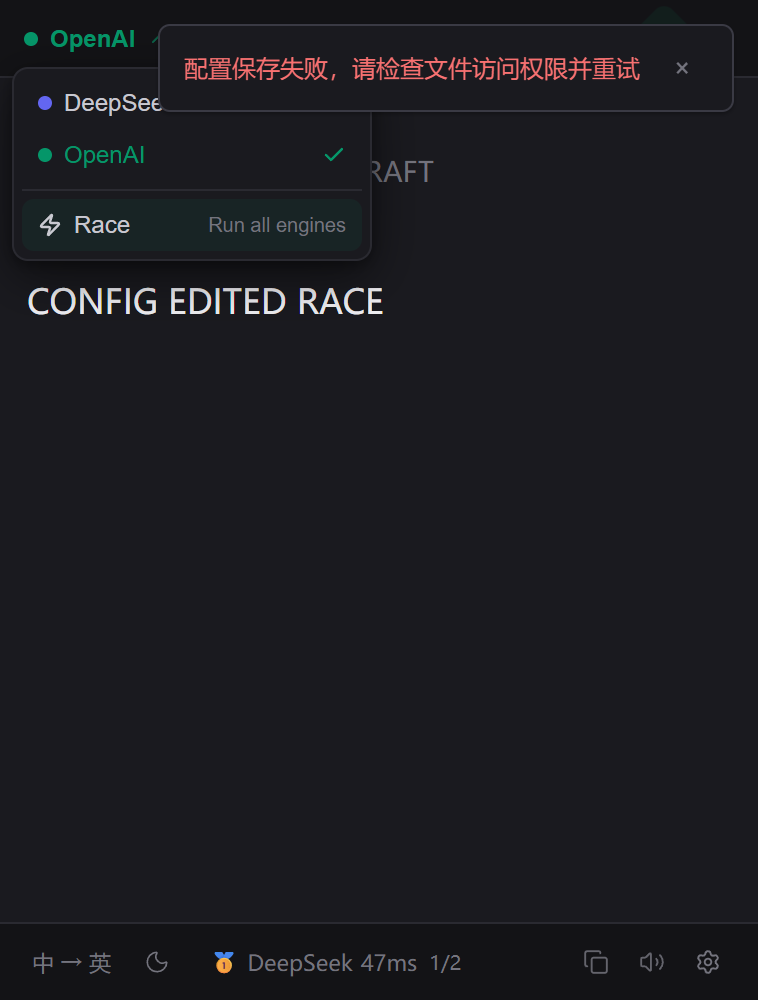

# Windows review-fix validation addendum

The actual Windows production executable built from **`15c32a52148399d6ff383d80874f60931954ee77`** passed **63 named functional checks: all 30 existing checks and 33 added provider-refresh checks**. Seven configuration-only phases each added **zero provider requests and no history**, while preserving source drafts, edited results, their actual engine provenance, and the same visible pinned renderer. The process exited naturally with code 0 after debugger disconnection; the outer memory-only clipboard guard restored all seven saved formats, and the immediate scoped process check found zero remaining candidate processes.

**Performance status addendum — 2026-10-23:** the same `F0D9E094…D03CE` payload now has an independent [complete 22/22 frozen-gate performance report](../performance/2026-10-23-review-production.md), with 38 attempts, 37 exact successes, zero capture timeouts, seven natural exits0 and four outer clipboard formats restored for that separate cohort. This is new latest-artifact evidence, not a transfer of the old `52059FFA…618E0` pass. The original functional run below remains unchanged; no new installer or Linux runtime was exercised, and all old failures are preserved.

Machine evidence: [2026-10-23-windows-review-15c32a5.json](2026-10-23-windows-review-15c32a5.json). The actual run was `2026-10-22T15:04:09.312Z`–`15:04:20.385Z`, **11,073 ms**, in the user's newly authorized approximately five-minute idle interval. This addendum was curated on October 23 without launching another application, accessing the clipboard, rebuilding, or repeating a test.

## Exact artifact and source

| Artifact | SHA256 |
| --- | --- |
| Production `EasyTranslate.exe` | `56049a52bb4e226b034f9c5ef6f50af3369b763e16584c3f15e6bdee729f5922` |
| Production `resources/app.asar` | `f0d9e094fcb66a662f7120420cc31d0263c5e594204d82d23554e2ed70bd03ce` |
| Compiled preload | `51f4d3d50d132301bf1a225f6e8e5fea62656ba096cd03209d82791df86bf342` |
| New HTML entry | `03df6dba921f7c1f92696929743552390c09dd7349d82ef3a0beaa84bf343136` |

A fresh exact Git archive at `E:/EasyTranslate-implementation-notes-20261020/windows-final-validation/source-review-15c32a5` was built once with `npm run build` and packaged once with the production `--win --dir --x64 --publish never` entry. It reused the existing E-owned private dependencies and verified Electron 43.2.0 distribution; `npmRebuild=false` skipped dependency rebuild/installation. Output, temporary directories, profile, caches and npm configuration were explicit E-owned paths. No original Electron/dependency tree, daily install or production packaging configuration was changed.

The packaged main, preload, desktop-runtime, provider-service, provider metadata and selection module are byte-identical to the previous `2e97ef0` artifact. HTML and renderer assets changed for the Popup.vue review fix. Every selected packaged file matches the independent compiled source. A Git comparison of `15c32a5` and root `bdbdc3c687146aab30439e1c81fd6a4fd7ae62e8` is empty for `electron`, `src`, icon assets, package/lockfile, packaging and compiler/Vite inputs; root's additional documentation does not change this product payload.

The authoritative root integration check at `d761d487463eca55d8dd740aefc2f957b55cc2aa` passed strict Electron/Vue types, **132/132 offline tests**, zero failures and production build. Its product inputs match `15c32a5`. This validator did not duplicate the full check. Log: `E:/EasyTranslate-implementation-notes-20261020/final-review-fixes/11-integrated-check.log`, SHA256 `14ed3901a417a9a8d15ee8d58e1045c2540496a118f624a2aec4f6b73a773008`.

## Provider-refresh regression proof

The added scenario follows the original `FINAL_VISIBLE` check and precedes the original close/tray/immediate-quit checks, leaving all 30 baseline checks in their existing order. It uses the owned renderer and public settings IPC, without physical keyboard/mouse injection or another application's state. Pinning is through the real Vue button. For each phase below, the test compares request count, full synthetic history, source/destination/result-label/race-state DOM, BrowserWindow and webContents identity, native visibility/always-on-top, and public pinned state.

| Configuration-only phase | Available/current settings after refresh | Unchanged evidence |
| --- | --- | --- |
| Disable selected DeepSeek | OpenAI becomes the available fallback | 0 requests, same history, edited single result and its DeepSeek provenance retained |
| Change next-request setting from single to race | Race setting becomes visible | 0 requests; existing single result and source draft retained |
| Disable both configured providers | `未配置API` none-state replaces the available list | 0 requests; existing edited result retained |
| Enable OpenAI from none-state | OpenAI choices recover without recreating popup | 0 requests; history/result/draft retained |
| Enable DeepSeek and race setting | Both providers and Race setting are available | 0 requests; completed edited single result retains OpenAI provenance |
| Change a completed race's next-request setting to single | OpenAI fallback becomes current | 0 requests; edited race result, comparison state and actual DeepSeek engine retained |
| Re-enable DeepSeek with valid current OpenAI | Both choices return; current OpenAI remains valid | 0 requests; previous race result/provenance retained |

Separate explicit UI actions then prove that a new single request uses the fallback provider, a new race invokes both configured synthetic providers, and a new DeepSeek selection uses the flash fixture. **Actual additional requests were six, not the preparation estimate of four.** Engine selection itself legitimately retranslates the current source, in addition to the explicit trigger calls. The recorded sequence is `FINAL_VISIBLE/slow`, `UI_EDIT/slow`, `UI_EDIT/fast`, `UI_EDIT/slow`, `UI_EDIT/fast`, `UI_EDIT/fast`. Two earlier explicit requests received cancellation attempts when superseded; controlled late replies remain recorded. These explicit actions are separate from the seven configuration-only phases, all of which remained at zero.

### Owned popup capture

The capture shows OpenAI selected for the **next** request, refreshed DeepSeek/OpenAI choices and Race menu, and `CONFIG EDITED RACE` with the previous result's **DeepSeek** footer. The dropdown covers part of the source draft; source-draft preservation is proven separately by DOM assertions. The red configuration-save-failure notification is deliberately retained feedback from an earlier synthetic write-failure check in the same baseline suite. This is not a claim that the UI contains no error message. The capture is from this owned BrowserWindow only; no new screenshot run or other-app capture was made during curation.

## Native guard proof and request scope

Before the packaged user entry resumed, `app.isReady()` was false and the harness passed isolated-profile, synthetic-provider, default-deny socket/transport and product-not-imported checks. All **12 negative-operation self-tests** passed. The unchanged controlled controller uses an OS/runtime environment allowlist and fixture HOME/USERPROFILE/app-data/temp; Electron appData, userData, sessionData, logs and crashDumps all resolve inside this run. Only exact synthetic credentials and `.invalid` in-memory provider transport are accepted; DeepSeek requests use `deepseek-v4-flash`.

There were **56 total in-memory requests** in the complete 30+33 run, zero unexpected-selection abort events and zero native copy-helper launches. The existing deliberate Copy checks still use the system clipboard under the outer STA DataObject snapshot and `finally` restoration. No physical selection/shortcut cohort, mouse gesture, tray-icon click or new native-focus proof is claimed by this run. Speech proof remains invocation with edited synthetic content, not audible output.

The injected native harness denies alternative Node/Electron/session/renderer transports and Node child APIs except the exact controlled copy helper boundary. It is not an OS firewall. Separately, `npm test` isolates profiles and blocks network in guarded Node processes and Node children inheriting `NODE_OPTIONS`; that unit guard does **not** intercept `child_process` or block native child launches. No personal credentials/config/history were read. Zero real provider calls here follows from controlled construction, not a provider billing audit.

## Reproduction and preserved scope

- Raw run: `E:/EasyTranslate-implementation-notes-20261020/windows-final-validation/functional-review-15c32a5-1`.
- Exact external runner: `.../review-guarded-runner-15c32a5-1`; its controller, injection and outer PowerShell guard were copied unchanged from source `15c32a5`, with only the composed functional suite adding this scenario. File hashes, summary/events hashes and profile paths are in the JSON.
- `prepared-manifest.json` remains frozen as a preparation artifact. Its `PREPARED ONLY` status and four-request estimate are not the completed-run verdict; the actual summary records the pass and six requests.
- Fresh builds are under `production-review-15c32a5/win-unpacked`; build logs are `build-review-15c32a5.txt` and `package-review-15c32a5.txt`. No NSIS was rebuilt or installed for this revision.

The prior [Windows report](2026-10-22-windows-packaged.md) and [Linux report](2026-10-22-linux-packaged.md) retain their original source/artifact identities. The old NSIS install/start/quit/uninstall result remains **prior `2e97ef0` payload evidence**; packaging and compiled main/preload/desktop/provider/selection are unchanged, but the new frontend was not installed through NSIS. Linux source `64a9727` includes `2e97ef0` and predates this Popup.vue fix; no new Linux runtime/package pass is claimed.

The earlier `F0D9…D03CE` performance attempt stopped before its first Alt+Q with no source-ready acknowledgement; its [incomplete proof](../performance/2026-10-23-review-production-incomplete.md) remains unchanged. A later fresh explicit five-minute grant permitted one [complete same-artifact cohort](../performance/2026-10-23-review-production.md), which passed all 22 frozen gates with unchanged scripts/limits. The requested source-window click was not recorded and the earlier cause is unconfirmed. The old [22-gate pass](../performance/2026-10-22-final-production.md) still belongs only to `52059…618E0`. The mutable [acceptance matrix](2026-10-22-final-acceptance.md) now links the independent latest pass while retaining the older evidence and coverage limits.

Earlier ordinary-foreground and same-clipboard limitations remain unchanged. So does the disclosed clipboard incident: functional1–8 overwrote the original clipboard before an outer snapshot existed; its original content cannot be restored from these fixtures and clipboard history was not inspected. This later seven-format restoration does not repair that incident. The earlier spending source also remains unresolved. Scheduled continuation remains disabled; no merge of the PR, release, version/tag/autostart change, daily-install replacement or remote action was performed by this validator.
