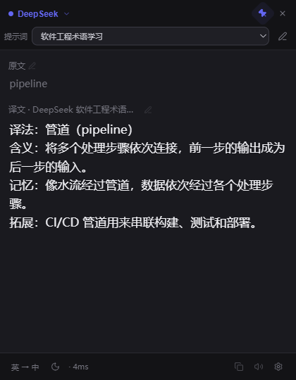

# Shared prompt presets: implementation and review evidence

Specification: [Issue #13](https://github.com/QMinitaitan/EasyTranslate/issues/13).
Review base: `aa20a13d95dcdb61ed3649ee69d9e8c32366d718` (main before this feature).
Initial candidate: `7eb19159deb637ed842d7bbd6e925b230c4eee06`.

## Standards

The independent Standards reviewer found one P2 violation of the documented pending-settings guarantee: a failed prompt draft survived view release but was not restored when reopening the editor. Editing another preset then superseded the retained collection with stale saved text. No separate material smell-baseline findings were reported.

The fix restores the existing pending-settings draft before the reopened editor accepts edits, transfers ownership to the new view, and exposes save/retry for that retained draft. The regression exercises failure → view release → reopen → edit a different preset → save/exit flush; it failed before the fix and passed afterward.

## Spec

The independent Spec reviewer found two P2 issues:

1. User story 28: remounting and editing another preset could lose the prior failed draft. Fixed as described above.
2. The primary IPC acceptance test replaced the internal translation function, falling short of the agreed real-provider test seam. It now keeps configuration, sessions and provider adapters real, intercepting only external HTTPS before importing main. From actual IPC handlers it verifies system/user message separation, target-language substitution, the allowed DeepSeek Flash model, DeepL payload/protocol, and successful single/race results. The strengthened test failed before installing the controlled external transport and passed afterward.

Both independent reviewers re-reviewed the full feature diff and the fixes through candidate `b99781f11aedeac8f8952be80935522b88e1238b`. Standards confirmed the documented pending-settings guarantee is restored and reported no remaining material smell findings. Spec confirmed user story 28 and the agreed real-provider IPC test seam are satisfied, with no remaining scope or behavior deviations found.

Final review summary: Standards 0 outstanding findings; Spec 0 outstanding findings. The reviewers performed read-only analysis; execution evidence below comes from the implementation checks.

## Validation and limits

- Final `npm run check` passed: strict Electron/Vue typechecking, 151 offline regression tests (151 passed, 0 failed), and production build. `git diff --check` passed.
- The failed-draft regression was observed failing before its production fix (150 passed, 1 failed), then passing after the fix. The strengthened real-provider IPC test was also observed failing before the fixture installed its controlled external transport, then passing afterward.
- All Node regressions run through `npm test`, which isolates profile/app-data directories and blocks real network access.
- No real model API request, native/Electron validation, installed-app launch, release or scheduled continuation is part of this validation.
- The previous synthetic browser check covered preset switching/retranslation, full-result copy, shared-editor navigation, saving, failed-save retention/retry, individual restore and reload persistence. The fixture installed its mock API and transport blocking before renderer import, with CSP `connect-src 'none'`.
- The screenshot below contains a synthetic response, not live model output. It verifies the popup layout, including the preset selector and complete-result display, at 420×540.

Real-model adherence to learning instructions and actual native desktop behavior remain unverified.
