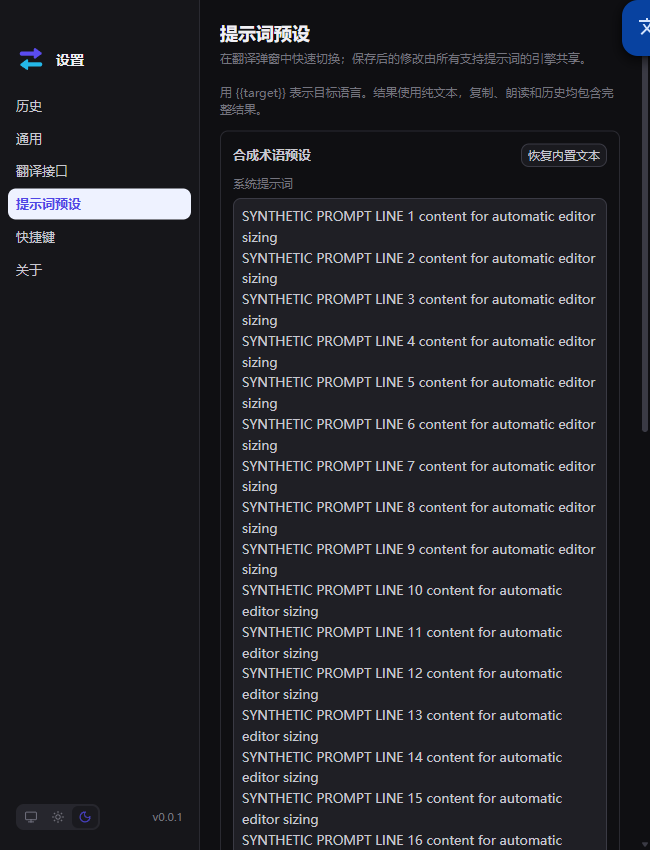
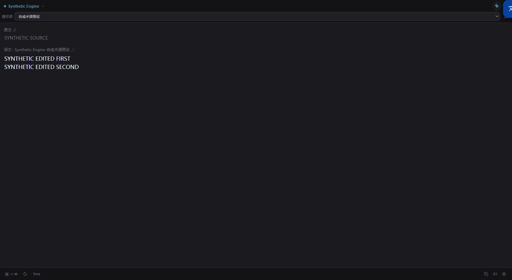

# Settings and popup interaction verification

Specifications: [#15](https://github.com/QMinitaitan/EasyTranslate/issues/15), [#16](https://github.com/QMinitaitan/EasyTranslate/issues/16), [#17](https://github.com/QMinitaitan/EasyTranslate/issues/17), [#18](https://github.com/QMinitaitan/EasyTranslate/issues/18).
Review base: `0a21069c72dc6e0181961ac88fa762e40048f885`.
Production candidate: `9c6993520ae041682f0af7759fec4675213ce4c0`.

## Result and scope

- Prompt textareas automatically grow and shrink with content and wrapping, using `field-sizing: content` with a four-line minimum. Unsupported browsers retain the previous manually resizable editor.
- Theme mode crosses the typed preload/main bridge and sets `nativeTheme.themeSource`, including `system` to remove an earlier override. Unknown modes and non-application senders are rejected.
- On Windows, caption double-clicks arrive through `WM_NCLBUTTONDBLCLK`, rather than a DOM event that native drag regions suppress. DPI/zoom conversion and renderer hit testing limit closing to the header. Closing reuses the existing path, including speech cancellation. Windows maximization is disabled for this resizable popup.
- Ctrl/Cmd+C over an unselected visible translation copies its current `innerText`, including uncommitted edits. Native selection copy and focus in other editors remain intact; copying does not translate or write history.

**Platform limit:** #17 is implemented and checked on Windows. Linux/Wayland retains native dragging but does not yet implement double-click-to-close. This delivery does not claim that behavior on Linux/Wayland.

## Standards

The independent Standards reviewer examined the production diff against repository instructions, TypeScript/runtime contracts and the Fowler smell baseline. No unresolved documented-standard violation or material smell was found.

The separate native-fixture audit identified missing HTTP/2, global WebSocket and ESM export interception, followed by missing explicit native app-data/temp paths and the external-shell boundary. These were corrected before running the fixture. No installed application was automated.

## Spec

The independent Spec reviewer found no blocking deviation in the Windows scope. The reviewer required the Linux/Wayland limitation above to be disclosed separately.

Review summary: Standards 0 unresolved production findings; Spec 0 Windows blockers, with the stated platform limitation.

## Offline regression evidence

- Theme regression tests first failed at the renderer, compiled preload and real main IPC seams, then passed after implementation.
- Native caption routing and renderer close tests were observed failing before their implementation, then passed.
- DeepSeek Flash, invoked through OpenCode with its listed identifier `deepseek/deepseek-flash`, implemented the bounded copy handler and six behavior tests. Root independently checked the code and corrected the fake DOM to preserve the identity behavior of actual DOM elements held in Vue refs.
- `npm run check` passed for the production candidate: strict Electron/Vue typechecking, 162 offline tests, production build.
- After adding five fail-closed native preflight tests, final `npm run check` passed: typechecking, 167 tests (167 passed, 0 failed), and production build. Those five tests evaluate invalid fixture invocations in a VM and do not launch native processes.
- `git diff --check` passed.

All application/API validation used synthetic data. There were zero real EasyTranslate translation/provider requests. The OpenCode coding delegation was separate from application API validation. No scheduled continuation or release was enabled.

## Browser evidence

Ego-browser loaded the built renderer on a fresh loopback origin. Synthetic `window.api` and transport blocking were installed before renderer import; CSP used `connect-src 'none'`. Clipboard writes were intercepted, including the native selection-copy event, so the test did not replace the user's clipboard.

Measured first-editor heights in CSS pixels:

| Scenario | Height | Visible content / scroll height |
| --- | ---: | --- |
| Initial 24-line synthetic prompt | 513 | 511 / 511 |
| Replace with short text | 97 | 95 / 95 |
| Paste 40 longer lines | 846 | 844 / 844 |
| Narrow viewport, more wrapping | 2510 | 2508 / 2508 |
| Save and reload | 2510 | 2508 / 2508 |
| Restore initial synthetic prompt at narrow width | 1012 | 1010 / 1010 |

Real keyboard/pointer operations confirmed hovered full-result copy without focus, uncommitted multiline edits, native partial-selection copy, source-focus protection and no copy outside the translation. The request counter stayed at one synthetic translation. Renderer hit testing ignored footer/control double-click points and closed for the header point. Two pages also synchronized light/dark/system selections through the storage event.

## Windows native evidence

The new manual-only `scripts/testing/run-settings-popup-native.ps1` launches the repository-local Electron with a new `.runtime` profile. Its JavaScript entry verifies explicit HOME/USERPROFILE/APPDATA/LOCALAPPDATA/TEMP/TMP, rejects startup hooks and credential-bearing environment names, fixes Electron appData/userData/sessionData/logs/crashDumps/temp/home paths, and writes only disabled synthetic providers. Node socket/HTTP(S)/HTTP2/fetch/WebSocket, Electron/session transport, child-process, shell, clipboard and global-shortcut boundaries are intercepted before importing the actual compiled main entry. The controller sends messages only to the fixture HWND and restores its thread DPI context; it does not move the user's pointer or press keys. Both sides have deadlines and terminate their own process.

The initial injected message run failed because the PowerShell sender was DPI-unaware: Windows scaled the physical LPARAM coordinates a second time. Diagnostic coordinates showed the message reaching the renderer outside the window. Setting the sender thread to per-monitor DPI awareness fixed the test injection without changing production code. Temporary message instrumentation was removed afterward.

The final native run passed on this Windows desktop:

- Actual settings renderer actions propagated `dark`, `light`, `system` through the real preload/main bridge to `nativeTheme.themeSource` and agreed with renderer theme state.
- A pinned popup remained visible after an injected footer caption double-click.
- An injected header caption double-click hid the popup.
- The popup remained unmaximized throughout; the settings window stayed hidden.
- Electron exited successfully, with no application provider calls.

This checks native message delivery and application closing, rather than physical mouse double-click hit testing. It does not provide a pixel/colorimeter assertion for the operating-system title bar, a Linux/Wayland test, or real-model translation quality evidence.

## Workflow retrospective

The existing Issues were sufficient specifications for a small `implement → TDD → code-review → PR` flow; no additional planning tickets were needed. The native caption path required its own isolated feedback loop because DOM-only tests cannot exercise Electron drag regions. Future native-message fixtures should set the sender DPI context explicitly. No global skill or repository steering files were changed.
